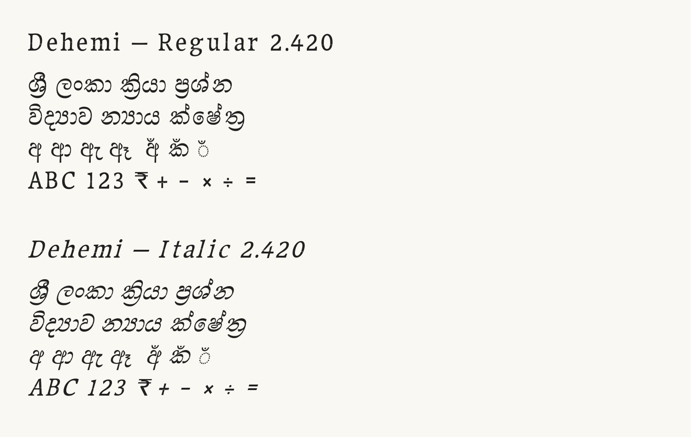

# Dehemi

Dehemi is a Maname-derived Sinhala display family with Regular and Italic styles, released under [SIL OFL 1.1](OFL.txt). The app-menu family name is **Dehemi**; choose Italic for the original slanted design.

The published release remains [2.440](https://github.com/anushannga/UF-Dehemi/releases/tag/v2.440). This branch prepares **2.441**, an unreleased candidate correcting embedded OFL license metadata and repository build/documentation. Local candidate QA is recorded below; new cross-platform CI is not yet verified.



*Published 2.440 specimen. Candidate drawing, hinting, layout and metric table bytes are identical; only the head and name tables differ. [Comparison](qa/metadata-change-2.441.json).*

## Build

Use Python 3.12 and a Bash shell, including Git Bash on Windows. From the repository root:

```sh
python -m pip install -r requirements.txt
bash sources/build.sh
```

The entry point runs the maintained implementations `sources/build.py` and `sources/fontmake-build.py`. It builds the canonical TTFs with a copy of `OFL.txt` in `fonts/ttf/dehemi/`, then the native UFO/fontmake development output in `build/fontmake/`, with shaping and cmap parity checks. Root `build.py` and `fontmake-build.py` remain compatibility entry points.

Run canonical validation and the full Fontspector audit from the repository root:

```sh
python validate.py
python audit.py
```

`audit.py` requires Fontspector 1.9.0 on PATH, or an executable supplied with `--fontspector /path/to/fontspector`. It supplies both TTFs and the bundled OFL file explicitly to the unmodified Google Fonts profile. Platform checks are recorded separately in `qa/`.

The canonical build compiles `sources/features.fea` and source-defined helpers while preserving the recorded Italic outlines and TrueType hint programs from `sources/Upstream-Tight232.ttx`. Regular removes the Italic shear from outlines and positioning anchors and is unhinted. Native fontmake output is also unhinted and differs in pixels from the canonical TTFs.

## Source and attribution

Dehemi retains Maname copyright and OFL terms. Pasan Anushanga is credited for modifications; ANUSHANGA K P is the release preparer. OpenAI Codex assisted with technical adjustments, the upright companion, source/build preparation and QA.

The TTX records the supplied derivative Tight-232 stage, not the original Maname drawing sources. SFD/UFO outlines and the initial feature source are reverse exports. Earlier upstream acquisition/design steps are not fully pinned. See [source history](documentation/SOURCE-HISTORY.md) for the inputs and limits of reproducibility.

## Candidate 2.441 QA and limits

Fontspector 1.9.0, unmodified Google Fonts profile with both fonts and OFL: **213 PASS, 8 WARN, 0 FAIL, 133 SKIP, 15 INFO**. All four required licensing results pass. Six warnings concern textured contours, acute joins and preserved Italic overlap/winding; two concern inferred serving subsets. Checks remain enabled. [Raw report](qa/fontspector-2.441.json), [audit inputs](qa/audit-context-2.441.json), [warning review](documentation/WARNING-REVIEW.md).

Candidate local checks pass 788 HarfBuzz cases, 5,585 FreeType renders and 790 Windows Uniscribe cases per style. The one-command build passes 789 Sinhala/29 Latin native fontmake comparisons per style and complete cmap parity. Reports: [canonical validation](qa/validation-2.441.json), [Windows](qa/windows-validation-2.441.json), [fontmake](qa/fontmake-validation.json).

An isolated local Chromium 151.0.7922.34 run passes conditional soft-hyphen checks in both styles. [Browser report](qa/browser-validation-2.441.json). New candidate Linux/macOS CI results remain to be verified.

Published 2.440 [three-platform evidence](qa/platform-validation-2.440.json) remains a historical baseline, not a candidate CI run. Its font-only audit was 207 PASS, 8 WARN, 0 FAIL, 137 SKIP, 15 INFO; it omitted the OFL collection input, so the PASS totals are not a count of new font fixes. These tests cover a recorded corpus and do not certify human design approval, Office/PDF export, DirectWrite or every application.

U+00AD is handled by application line breaking rather than encoded; U+2010 supplies its visible hyphen. Raw APIs preserving default ignorables can return .notdef for U+00AD. Shared line metrics are 1500 units, as in 2.430; unusually stacked marks need separate review.

## Google Fonts onboarding

Continue the existing [submission #11099](https://github.com/google/fonts/issues/11099). The author must personally review and confirm the [submission requirements](documentation/ONBOARDING.md), as [requested by the maintainer](https://github.com/google/fonts/issues/11099#issuecomment-6137696893). Successful checks alone do not establish acceptance or Google Docs availability.

The `cla/google` check on the final head of [nam-files PR #32](https://github.com/googlefonts/nam-files/pull/32/checks) succeeded. Coverage of every relevant copyright holder for this font submission remains unconfirmed. That subset PR is **closed, unmerged**; Google Fonts maintainers handle serving subsets during onboarding. Its [patch and investigation](documentation/SUBSET-COVERAGE-PROPOSAL.md) are historical evidence.
